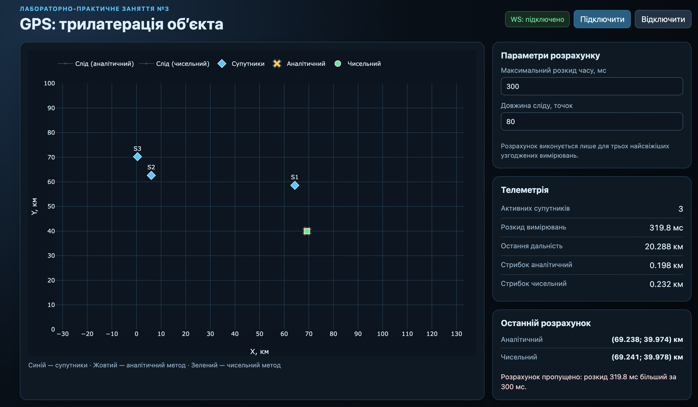

# Лабораторно-практичне заняття №3 — Візуалізація GPS-вимірювань

## Опис роботи

Веб-додаток у реальному часі зчитує вимірювання супутників із GPS-емулятора, обчислює дальність до кожного супутника та визначає координати рухомого об’єкта двома методами трилатерації. На декартовому графіку з межами від `0` до `100` км одночасно показано супутники, обидва обчислені положення та їхні сліди.

Реалізовано:

- підключення до `ws://localhost:21701` через WebSocket;
- зберігання останнього пакета для кожного UUID супутника та очищення застарілих даних;
- розрахунок дальності у кілометрах:

$$
R = 300(receivedAt - sentAt)
$$

- перевірку часової узгодженості трьох найсвіжіших вимірювань;
- аналітичне розв’язання системи трьох кіл з перевіркою нестійкого знаменника;
- чисельну мінімізацію суми квадратів похибок;
- оцінку середнього «стрибка» координат для обох методів.

## Обраний чисельний метод — варіант 1

Використано готову JavaScript-бібліотеку [numeric.js](https://www.npmjs.com/package/numericjs). Функція `numeric.uncmin()` мінімізує функцію втрат:

$$
L(x,y) = \sum_{i=1}^{3}\left(\sqrt{(x-x_i)^2+(y-y_i)^2}-r_i\right)^2.
$$

Початковим наближенням є аналітичний розв’язок. Це прискорює збіжність і не дозволяє оптимізації стартувати далеко від цільової точки. Якщо аналітичне рішення недоступне, застосунок використовує останню знайдену чисельну позицію.

## Запуск

### 1. Запуск GPS-емулятора

```bash
docker pull iperekrestov/university:gps-emulation-service-2026
docker run --rm --name gps-emulator -p 21701:4000 iperekrestov/university:gps-emulation-service-2026
```

Перевірка сервісу:

```bash
curl http://localhost:21701/config
```

### 2. Запуск застосунку

У новому терміналі відкрийте каталог `pr-3` і запустіть локальний HTTP-сервер:

```bash
cd pr-3
python3 -m http.server 8080
```

Відкрийте у браузері `http://localhost:8080`. Застосунок автоматично підключається до емулятора; за потреби з’єднання можна керувати кнопками у верхній частині сторінки.

> Для завантаження `Plotly` і `numeric.js` потрібне інтернет-з’єднання, оскільки бібліотеки підключено з CDN.

## Обґрунтування порогу часу

Типове значення порогу — **300 мс** (його можна змінити в інтерфейсі). Похибка дальності становить приблизно 100 м, тобто 0.1 км. Навіть за швидкості об’єкта 100 км/год за 300 мс він зміститься лише на:

$$
100 \cdot \frac{0.3}{3600} \approx 0.0083\ \text{км} = 8.3\ \text{м},
$$

що значно менше за похибку вимірювання. Отже, такий поріг відсікає явно застарілі вимірювання, але не втрачає корисні набори даних через звичайну асинхронність пакетів.

## Висновки

Аналітичний метод швидко дає точку перетину кіл, але сильніше реагує на шум дальності та нестійкий, коли супутники майже колінеарні. Чисельний метод мінімізує сумарну похибку для всіх вимірювань, тому його положення зазвичай стабільніше. У правій панелі показано середню довжину послідовних зміщень («стрибків»), що дозволяє порівняти поведінку методів під час роботи емулятора.

## Скріншоти

