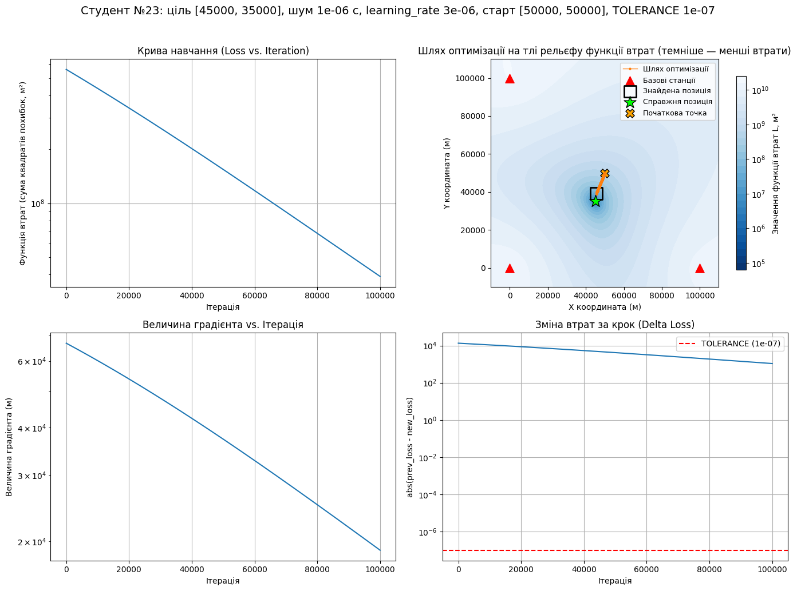
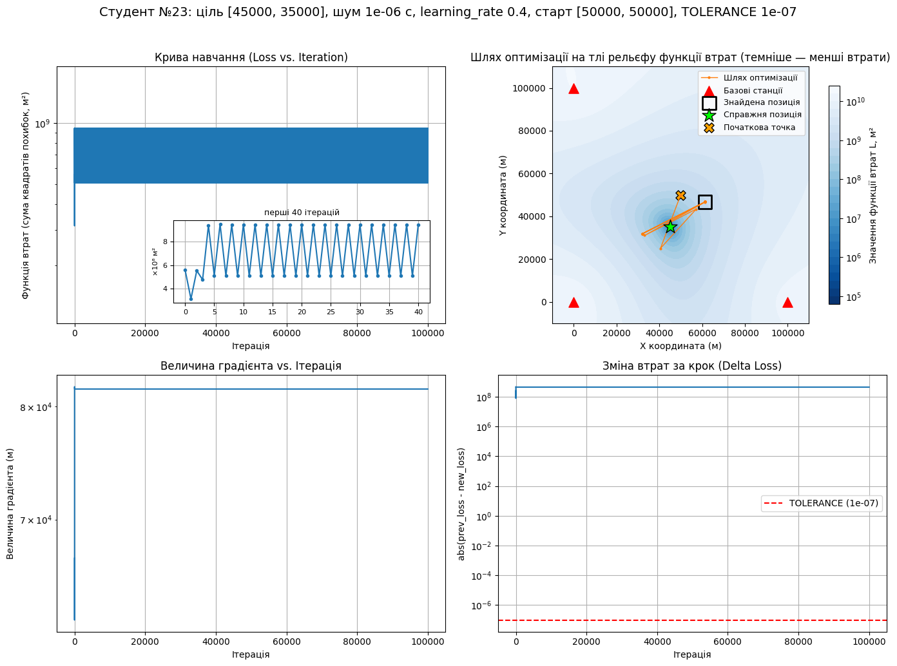
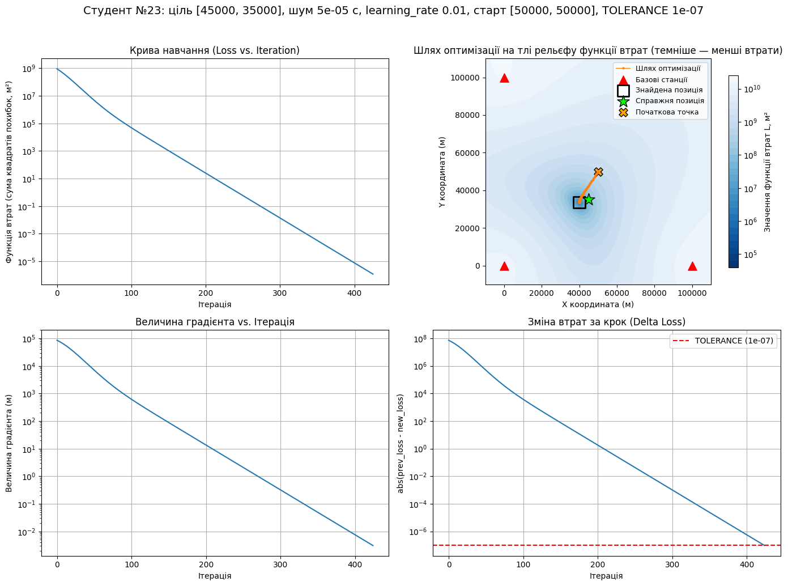
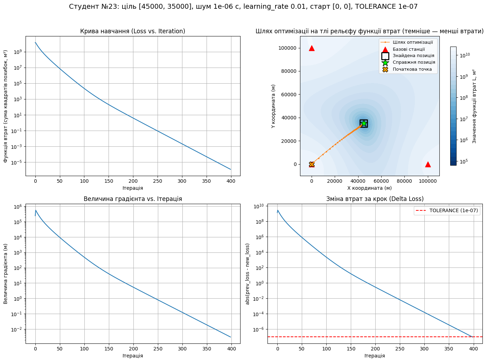
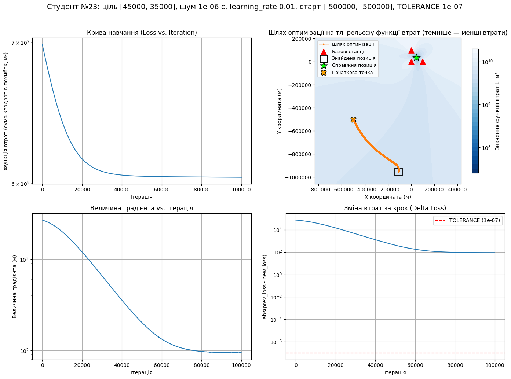
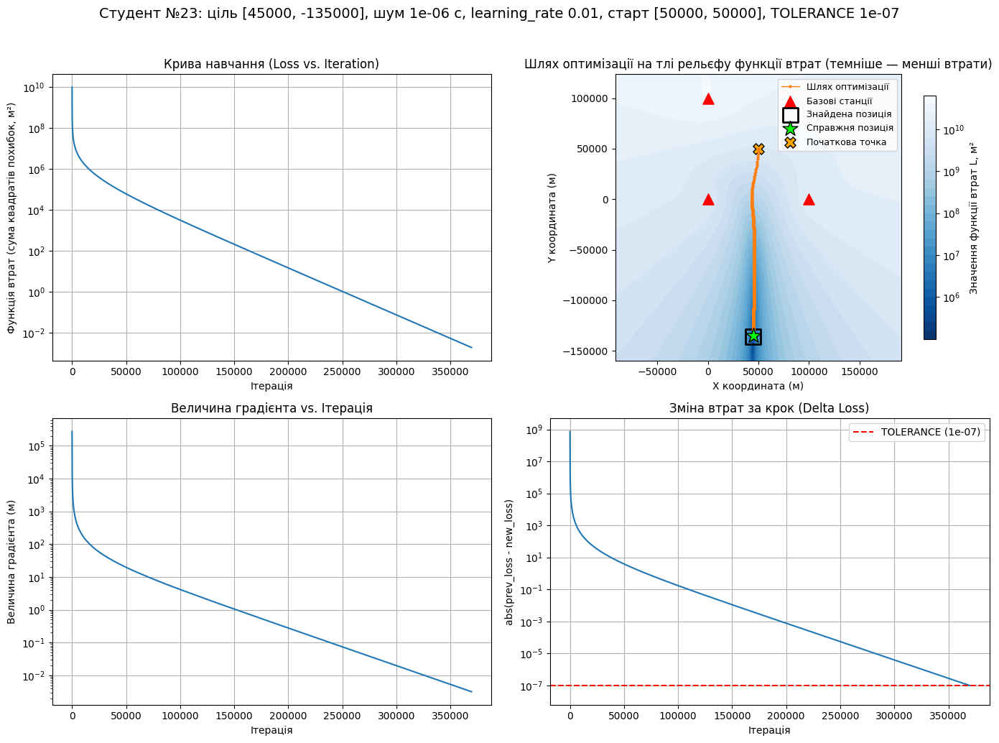
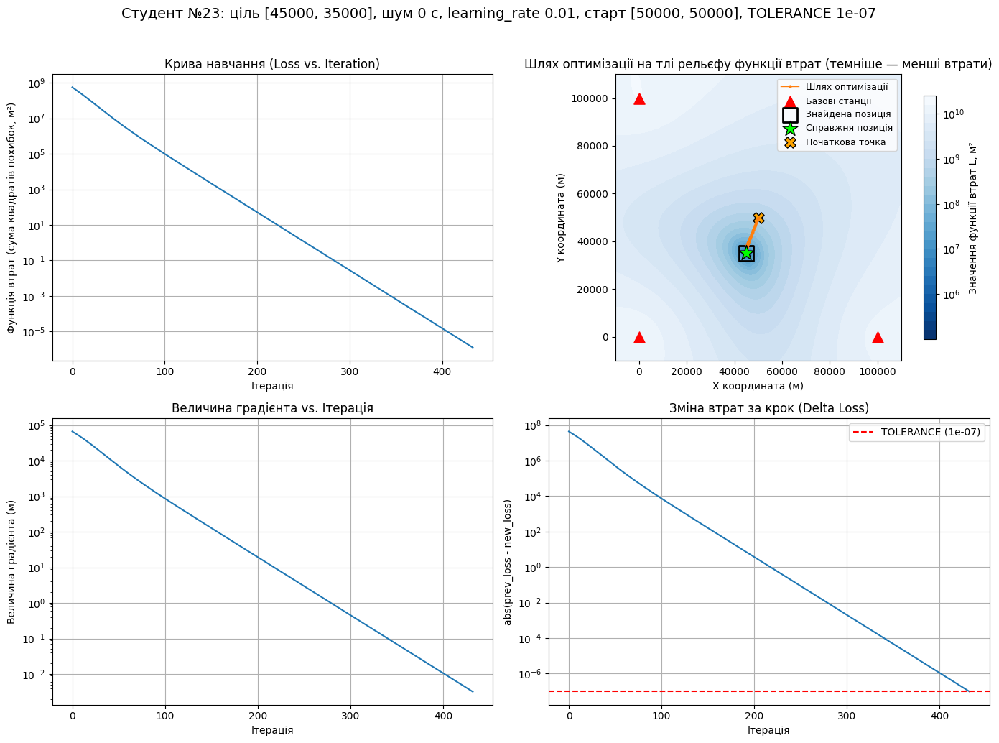

# Звіт до лабораторно-практичного заняття №4

## Дослідження методу градієнтного спуску для розв’язання задачі мультилатерації (TDoA)

**Студент:** №23
**Базові налаштування:** станції в точках (0, 0), (100 000, 0), (0, 100 000) м; ціль (45 000, 35 000) м; шум 0; `LEARNING_RATE` = 0.01; старт (50 000, 50 000) м; `TOLERANCE` = 1e-7; `MAX_ITERATIONS` = 100000.

---

### Експеримент 1. Контрольний запуск («Ідеальний світ»)

**Виклик:**

```python
run()

```

**Результат:**
Студент №23
Справжня позиція: (45000.00, 35000.00) м
Знайдена позиція: (45000.00, 35000.00) м
Похибка позиціонування: 0.000830 м (0.83 мм)
Ітерацій: 433 (зупинка: зміна втрат за крок < TOLERANCE = 1e-07)
Фінальне значення функції втрат: 1.27e-06 м²


**Відповіді на питання:**

1. **Чому похибка не дорівнює нулю, хоча шуму немає?** Похибка не дорівнює абсолютному нулю, оскільки алгоритм градієнтного спуску зупиняється не тоді, коли знаходить точну позицію, а коли зміна функції втрат за один крок стає меншою за задане значення `TOLERANCE` (1e-07).


2. **Порівняйте графіки «Величина градієнта» і «Крива навчання». Як вони пов’язані?** Обидва графіки спадають логарифмічно та синхронно. У міру наближення до мінімуму функції втрат, поверхня (рельєф) стає більш похилою, тому величина градієнта зменшується. Відповідно, хоча `learning_rate` залишається сталим, сам крок алгоритму стає меншим через зменшення градієнта, на який він множиться.


---

### Експеримент 2. Швидкість навчання («Проблема Золотоволоски»)

**Виклики:**

```python
run(noise_level=1e-6, learning_rate=3e-6)   # 2a
run(noise_level=1e-6, learning_rate=0.01)   # 2b
run(noise_level=1e-6, learning_rate=0.2)    # 2c
run(noise_level=1e-6, learning_rate=0.4)    # 2d

```

**Результати:**

| Запуск | learning_rate | Ітерацій | Причина зупинки | Похибка, м | Фінальне значення втрат, м² |
| --- | --- | --- | --- | --- | --- |
| 2a | 3e-6 | 100 000 | вичерпано MAX_ITERATIONS | 4135.36 | 3.91e+07 |
| 2b | 0.01 | 433 | зміна втрат за крок < TOLERANCE | 104.54 | 1.25e-06 |
| 2c | 0.2 | 14 | зміна втрат за крок < TOLERANCE | 104.54 | 5e-09 |
| 2d | 0.4 | 100 000 | вичерпано MAX_ITERATIONS | 20147.73 | 9.42e+08 |




**Відповіді на питання:**

1. **2a:** Алгоритм не зійшовся, оскільки швидкість навчання була занадто малою (стагнація). За 100 000 ітерацій втрати впали недостатньо для досягнення мінімуму.


2. **2d:** З кроком 0.4 алгоритм не сходиться, а показує розбіжність і осциляцію — точка постійно «перестрибує» мінімум. Через це втрати не лише не зменшуються, а й залишаються на високому рівні (9.42e+08 м²).


3. **Чому learning_rate — найважливіший гіперпараметр?** Замалий крок призводить до того, що алгоритм не встигає досягти мінімуму за розумний час (2a), а завеликий — спричиняє осциляцію або розбіжність (2d). Оптимальний крок має бути достатньо великим для швидкої збіжності, але не таким, щоб перестрибувати мінімум.


---

### Експеримент 3. Рівень шуму («Сміття на вході — сміття на виході»)

**Виклики:**

```python
run(noise_level=1e-9)   # 3a
run(noise_level=1e-6)   # 3b
run(noise_level=5e-5)   # 3c

```

**Результати:**

| NOISE_LEVEL (с) | Шум у метрах (c⋅ NOISE_LEVEL) | Ітерацій | Похибка, м | Фінальне значення втрат, м² |
| --- | --- | --- | --- | --- |
| 1e-9 | 0.30 | 433 | 0.104717 | 1.27e-06 |
| 1e-6 | 300 | 433 | 104.54 | 1.25e-06 |
| 5e-5 | 15000 | 425 | 5166.94 | 1.19e-06 |



**Відповіді на питання:**

1. **Збіжність 3c:** Алгоритм успішно зійшовся до мінімуму, але це мінімум "спотвореної" шумом функції втрат. Великий шум на вході змістив гіперболи, тому перетин відбувся у хибній точці (похибка 5166.94 м), хоча сама функція втрат у цьому новому мінімумі є близькою до нуля (1.19e-06 м²). За значенням функції втрат цю помилку не виявити, оскільки алгоритм "вважає", що успішно розв'язав математичну задачу.


---

### Експеримент 4. Початкове наближення («Чи всі дороги ведуть до мінімуму»)

**Виклики:**

```python
run(noise_level=1e-6, initial_guess=[50000, 50000])       # 4a
run(noise_level=1e-6, initial_guess=[0, 0])               # 4b
run(noise_level=1e-6, initial_guess=[-500000, -500000])   # 4c

```




**Результати:**

| Запуск | Старт, м | Ітерацій | Причина зупинки | Похибка, м | Фінальне значення втрат, м² |
| --- | --- | --- | --- | --- | --- |
| 4a | (50000, 50000) | 433 | TOLERANCE | 104.54 | 1.25e-06 |
| 4b | (0, 0) | 399 | TOLERANCE | 104.54 | 1.19e-06 |
| 4c | (-500000, -500000) | 100 000 | вичерпано MAX_ITERATIONS | 1000320.40 | 6.04e+09 |

**Відповіді на питання:**

1. **Порівняння:** 4a та 4b сходяться до однакової похибки (104.54 м) приблизно за однакову кількість ітерацій. Але старт 4c знаходиться занадто далеко.
2. **Форма функції:** Функція втрат не є ідеальною «чашею». Далеко від станцій рельєф стає майже пласким (градієнт близький до нуля), оскільки різниця відстаней між будь-якою далекою точкою та двома станціями наближається до константи (відстані між самими станціями). Точка «застрягає» на плато.


3. **Автоматичне розпізнавання хибної відповіді:** Фінальне значення функції втрат у 4c (6.04e+09 м²) на багато порядків більше, ніж у 4a (1.25e-06 м²). Аномально великі втрати після завершення алгоритму свідчать про те, що правильний мінімум так і не було знайдено.

---

### Експеримент 5. Геометрія станцій («Прокляття плаского каньйону», GDOP)

**Виклики:**

```python
run(noise_level=1e-6, true_position=[45000, 35000])     # 5a
run(noise_level=1e-6, true_position=[45000, -135000])   # 5b
run(noise_level=1e-6, true_position=[45000, -135000], max_iterations=1000000)   # 5c

```

**Результати:**

| Запуск | Ціль, м | Ітерацій | Причина зупинки | Похибка, м | Фінальне значення втрат, м² |
| --- | --- | --- | --- | --- | --- |
| 5a | (45000, 35000) | 433 | TOLERANCE | 104.54 | 1.25e-06 |
| 5b | (45000, -135000) | 100 000 | вичерпано MAX_ITERATIONS | 626.97 | 3.1e+03 |
| 5c | (45000, -135000) | 369 457 | TOLERANCE | 968.57 | 0.0019 |



**Відповіді на питання:**

1. **5a проти 5c:** Хоча рівень шуму однаковий (1e-6), похибка у 5c (968.57 м) майже вдесятеро більша за 5a (104.54 м). Це пояснюється геометричним розмиванням точності (GDOP): ціль 5c лежить далеко збоку від станцій, де гіперболи перетинаються під гострим кутом. Навіть малий зсув вимірювань через шум спричиняє величезний зсув точки перетину гіпербол.


2. **Чому 5b не зупинився:** Мінімум функції втрат у цьому випадку лежить на дні вузького і дуже довгого «каньйону» з майже пласким дном. Через малий градієнт на дні каньйону спуск відбувається вкрай повільно, тому 100 000 ітерацій виявилося недостатньо.


3. **5b проти 5c:** Додаткові ітерації у 5c (369 457) дозволили алгоритму знайти реальний мінімум спотвореної функції, проте похибка стала навіть гіршою (968.57 м проти 626.97 м у 5b). Це демонструє, що ідеальний оптимізатор не може виправити фізичні обмеження (погану геометрію станцій і шум).

---

### Експеримент 6 (бонус). Умова зупинки («Ціна точності»)

**Виклики:**

```python
run(tolerance=1e-2)                      # 6a
run(tolerance=1e-7)                      # 6b
run(tolerance=1e-12)                     # 6c
run(noise_level=1e-6, tolerance=1e-2)    # 6d
run(noise_level=1e-6, tolerance=1e-12)   # 6e

```

**Результати:**

| Запуск | TOLERANCE | Шум, с | Ітерацій | Похибка, м | Фінальне значення втрат, м² |
| --- | --- | --- | --- | --- | --- |
| 6a | 1e-2 | 0 | 280 | 0.260860 | 0.125 |
| 6b | 1e-7 | 0 | 433 | 0.000830 | 1.27e-06 |
| 6c | 1e-12 | 0 | 587 | 0.000003 | 1.2e-11 |
| 6d | 1e-2 | 1e-6 | 280 | 104.59 | 0.124 |
| 6e | 1e-12 | 1e-6 | 586 | 104.54 | 1.27e-11 |





**Відповіді на питання:**
За відсутності шуму, «платити» додатковими ітераціями за надточну умову (6c) має сенс — похибка знижується до мікрометрів. Однак із реальним шумом (6d, 6e), посилення `TOLERANCE` вимагає вдвічі більше ітерацій (586 проти 280), але майже не покращує похибку (104.54 м проти 104.59 м). `TOLERANCE` відповідає лише за глибину спуску до мінімуму, але він не може виправити початкове спотворення координатної сітки, викликане шумом.

---

### Загальний висновок

* **Швидкість роботи градієнтного спуску** залежить від кроку навчання (`learning_rate`) та початкової позиції. Якщо крок замалий або початкова точка знаходиться далеко (на ділянках з малим градієнтом), алгоритм стагнує. Якщо крок завеликий — виникає осциляція.
* **Точність результату** залежить від наявності шуму у вимірюваннях, геометрії розташування приймачів (GDOP) та параметру зупинки (`TOLERANCE`).
* Те, що **«алгоритм зупинився»**, свідчить лише про те, що він знайшов математичний мінімум заданої цільової функції (або вичерпав ліміт ітерацій). Але через геометричне розмивання точності (GDOP) та шуми, цей знайдений математичний мінімум може знаходитись за кілометри від реальної позиції цілі.